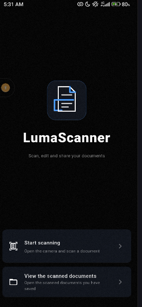
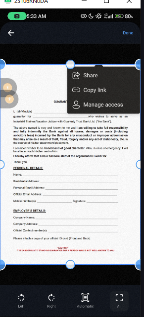
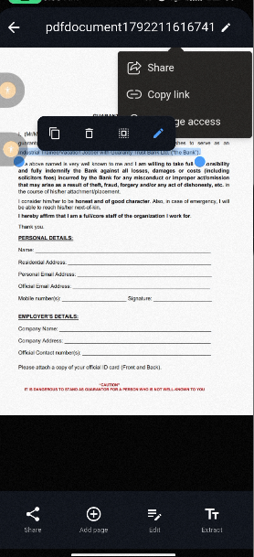
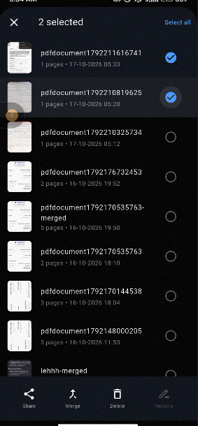

# LumaScanner

## What it is?

Basically, usera open the app then point the camera at a page/document and snap it, the user can keep taking pictures for multiple pages or import pictures from their gallery instead. After that, the user can click on the preview button to see their selected/snapped documents, it is at this stage that auto-enhancement happens too so that the document actually looks like a scan and not a photo of a desk. Users can also crop each page using auto-detection or crop it manually if auto-detection fails, they can also perform rotation and reordering of pages as well as deletion. Once the done button is tapped, the pdf view screen pops up

Another thing i implemented is that the text on every page in the is read with OCR, so, the user can tap on a line to select the text on that line, or long-press and drag to select an area They can also copy delete select and even edit the text on the pdf page. Another thing is that the user can also choose to extract all the pdf text and copy it.

## What the app can do?

### Scanning
Take multiple images and import pictures of documents that needs to be scanned from the gallery at once, turn on the flash light if the room is too dark, auto-enhance the selected pages and carry out cropping and rotation. Also, reordering and deletion of selected pages

### Inside a document
The users can actually copy, edit, delete texts on a pdf page, extract the whole text of a document on one screen, the app also gives users room to add more pages later (from the camera or from the gallery) as well as edit the pages again after making the PDF. Users can also share and rename the document.

### Scanned document page
Each of the scanned documents has a thumbnail of its page count and date created. Also, a view all which changes to a shpw less button depending on what we have for long lists of documents, selection of one or more documents for sharing, merging, deletion or renaming. I also added a progress indicator to show the process of merging the documents together.

### How text editing works
I made use of OCR since it gives every word and exactly where it is on a page. When a user edit a line, the app basically checks the colour around the words, paints that colour over that line/word then draw the edited text on top. The colour is the same as the original text, but the size and weight might change hence why I allowed users to manually adjust those. Also, OCR affects currency(something like expressing # as N), so, i added shortcut buttons in case the pdf document the user wants to edit the text has currency in it.

## Permissions and Platform
Platform: Android, Permissions Required: Camera access

## Framework & Packages Used
I built this with Flutter. Main packages:
camera,
image_picker,
image,
pdf,
pdfx,
share_plus,
path,
path_provider,
document_scan,
flutter_launcher_icons,
google_mlkit_text_recognition

## Download
Get the latest APK from the Releases page.
Not sure which APK to pick? Choose app-arm64-v8a-release.apk. It works on almost all modern phones.

## Installing (Android)
Download the APK on your phone.
Open it and allow installs from unknown sources if your phone asks.
Open LumaScanner and allow camera access when requested.

## Running from Source
Install Flutter.
Clone the repository and run flutter pub get.
Run flutter run with a physical phone connected (the camera works best on a real phone and not on an emulator).

## LICENSE
MIT License

## Limitations
Only work for android devices for now

Automatic edge detection might fail for documents with not so well defined background, but i added a manual crop fallback.

Editing a text on the pdf page might cause changes to the text font size and font weight...can be adjusted manually also.

## Screenshots from the app.

